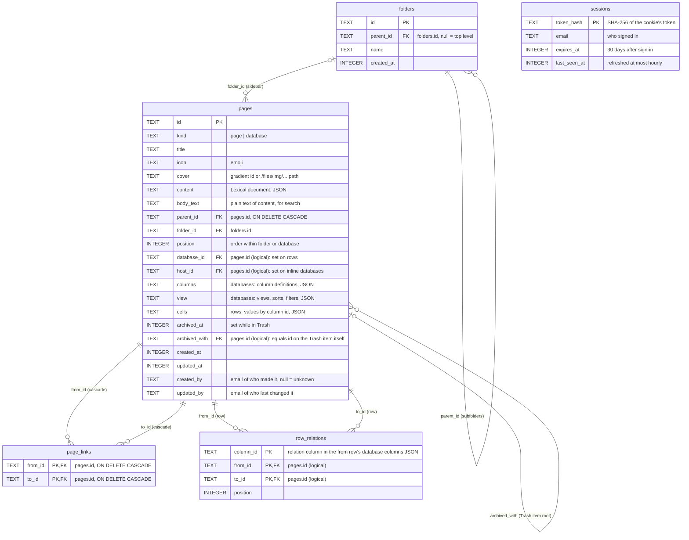

# Database schema

The `main` D1 database (`MainDb`), as built by `app/db/main/migrations/0001_init.sql`.

## Notes

- **`pages` holds three kinds of thing.**
  - **Pages and databases** are told apart by `kind`.
  - **Rows** are pages with `database_id` set; their values are in `cells`.
  - **Inline databases** have `host_id` set to the page that embeds them.
  - Rows and inline databases don't appear in the sidebar.
- **Real foreign keys vs. logical ones.**
  - Declared in SQL: `pages.parent_id` (cascades), `pages.folder_id`, `folders.parent_id` and both `page_links` columns (cascade).
  - Kept only by the app: `database_id`, `host_id`, `archived_with` and both `row_relations` page columns. Nothing in SQL enforces these; the app cleans them up itself.
- **Trash.**
  - Every page removed in one delete gets the same `archived_with`: a database plus its rows, or a page plus its inline databases.
  - The removed page itself is the Trash item, the row where `archived_with = id`.
  - Restore and purge act on the whole group.
- **`row_relations.column_id`** points into the `columns` JSON of the `from_id` row's database, not to a table. A two-way relation's other side reads the same links from `to_id`.
- **`page_links`** records which pages link to which. It's rebuilt from `content` on save.
- **`sessions`** is who's signed in. There is no users table: the workspace is shared by the emails in `ALLOWED_EMAILS`, which is checked on every request. A daily cron deletes ended sessions.
- **Indexes:**
  - `pages`: `(parent_id, created_at)`, `(folder_id, created_at)`, `(folder_id, position)`, `(database_id, position)`, `host_id`, `archived_at`, `archived_with`.
  - `folders`: `(parent_id, name)`.
  - `page_links`: `to_id`.
  - `row_relations`: `from_id`, `to_id`.
